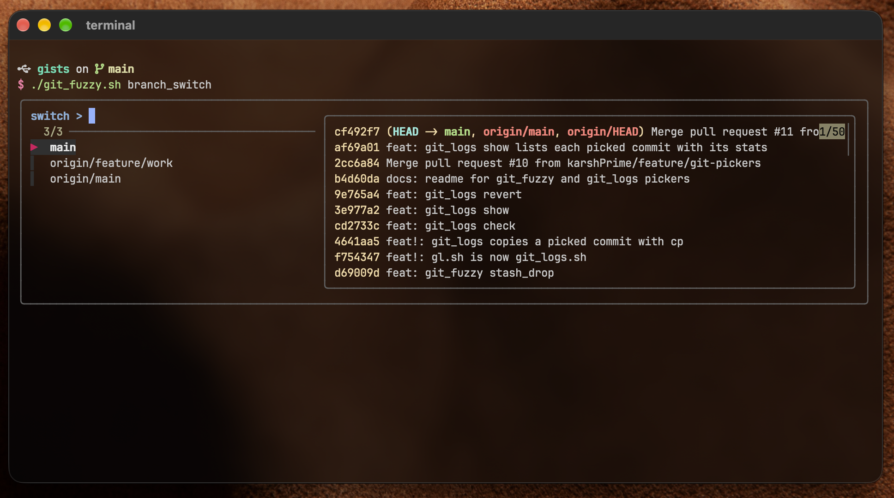
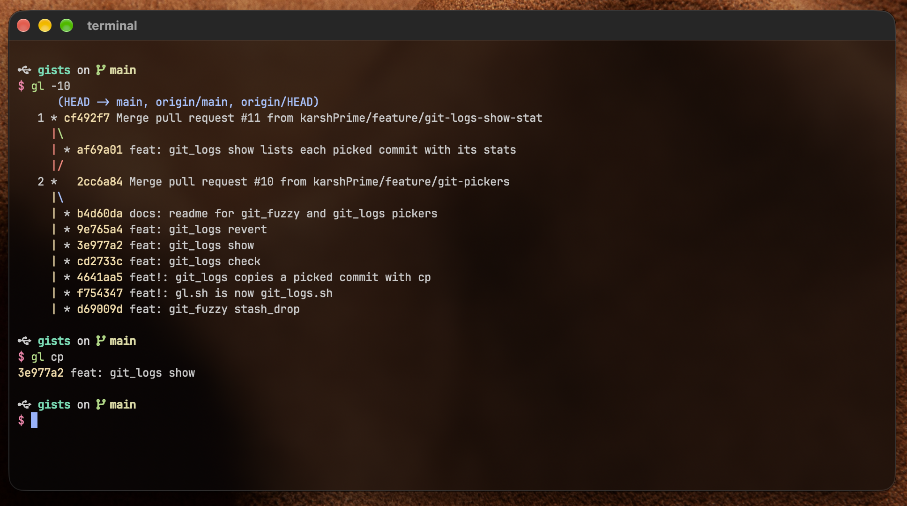
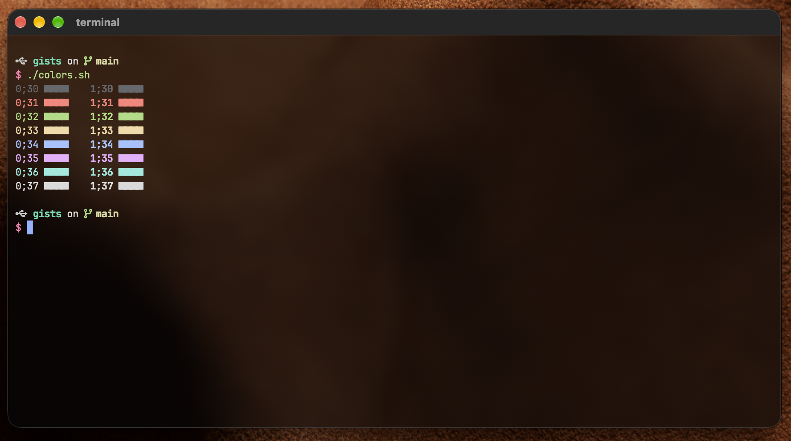
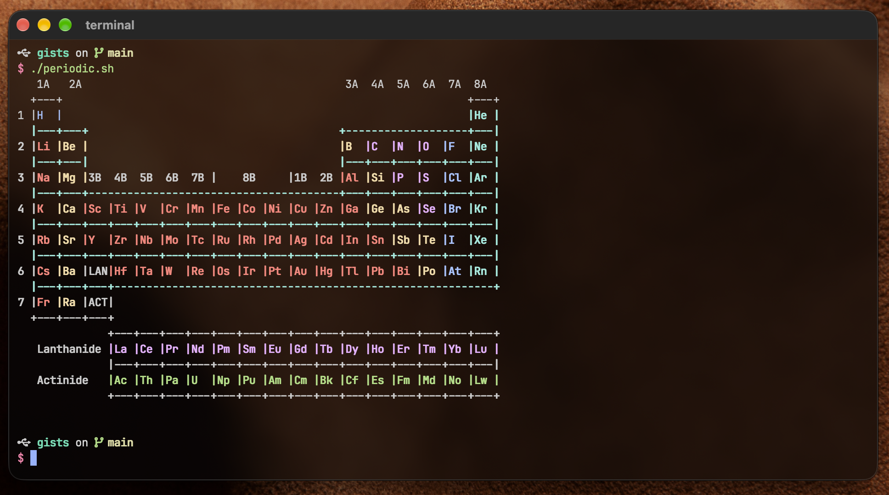
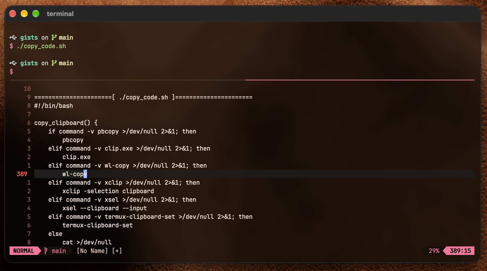
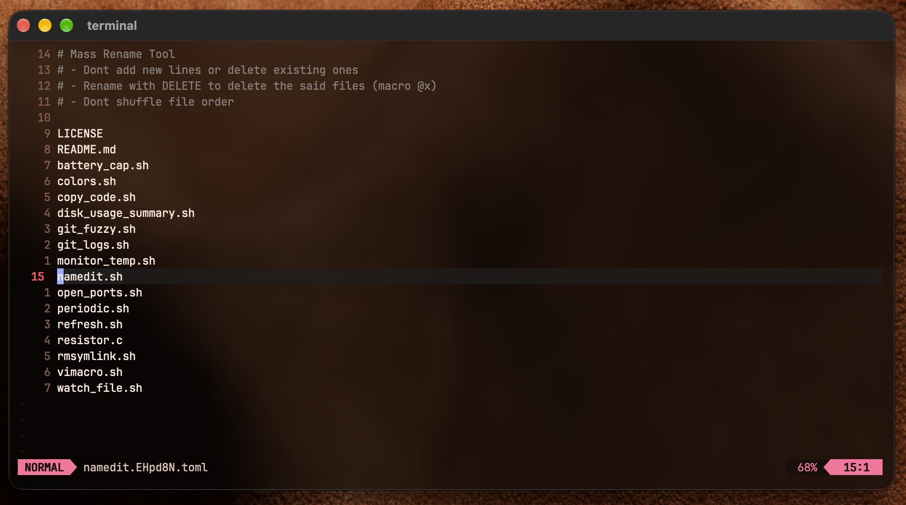
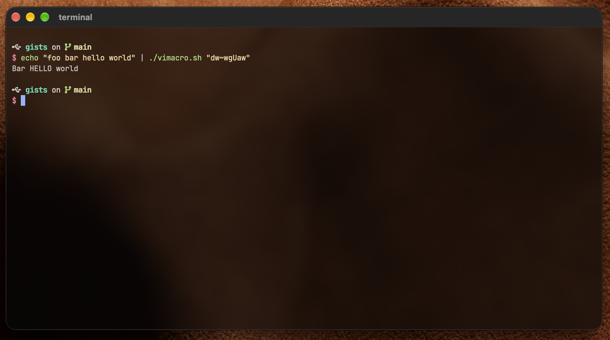

# Gists

A collection of independent shell scripts designed to power up the terminal
experience. Each script solves one specific task with no cross-dependencies -
drop any of them onto `$PATH` and use it on its own.

<details>
<summary>Git</summary>

### `git_fuzzy.sh`


Fuzzy pickers for everyday branch, worktree, stash, staging and restore chores, built on `fzf`. Add or
remove worktrees, switch to, make local, rebase onto or delete branches, each
picked from a list with a preview of its recent log. `worktree_check` and
`branch_check` open a remote branch as a detached checkout, without fetching it
or making a local branch. `stash_pop` and `stash_drop` pick stashes with a
`git stash show` preview. `stage_select` lists every uncommitted change, labelled
staged, modified, deleted or untracked, with the staged ones already picked;
pick or unpick files with tab to stage or unstage them. A partly staged file
gets a staged and a modified entry: pick the first to unstage it, the second to
stage all of it, or neither to leave it be. It needs `fzf` 0.46 or later.
`restore` discards the unstaged changes to the picked files, after a single
confirmation for all of them.

`branch_switch`, `rebase_branch` and `worktree_switch` take an optional branch
name to skip the picker; an unknown name is reported and the picker opens
instead. Worktrees go in `.worktrees/`, named after the last part of the
branch, so `feature/dark-mode` lands in `.worktrees/dark-mode`.

`worktree_switch` lists the main checkout and every worktree in `.worktrees/`.
A script cannot change its caller's directory, so it prints the picked path;
wrap it in a shell function to `cd` there:

```sh
gw() { local d; d=$(git_fuzzy.sh worktree_switch "$@") && [ -n "$d" ] && cd "$d"; }
```

### `git_logs.sh`


Enhanced `git log` visualiser. Renders the commit graph with coloured refs, formatted
dates, and tidied decorations via an `awk` post-processor. With `fzf`, `cp` copies a
picked commit's id, `check` checks it out, and `show` and `revert` run on every
picked commit. Formerly `gl.sh`, where `cp` was called `fzf`.

</details>

<details>
<summary>Maintenance</summary>

### `battery_cap.sh`
Limit a laptop battery from overcharging. Define a maximum charge limit inside
the script; if the model is supported, it installs a systemd service that caps
charging at the specified threshold.

### `refresh.sh`
Drop system caches and report memory usage before and after — total, used,
free, shared, and buffer/cache.

</details>

<details>
<summary>Monitoring</summary>

### `disk_usage_summary.sh`
Report the top space-consuming directories and files, sorted by size. Helps identify what
is eating up disk space on your system.

### `monitor_temp.sh`
Monitor CPU and GPU temperatures in real-time and alert when thresholds are exceeded.
Helps prevent thermal throttling and hardware damage.

### `open_ports.sh`
List all currently listening network ports and the processes bound to them. Quick way to
see what services are running.

### `watch_file.sh`
Tail a file for changes and trigger notifications when new content is added. Great for
monitoring logs in real-time.

</details>

<details>
<summary>Reference</summary>

### `colors.sh`


Print every terminal colour alongside its escape sequence. Useful as a visual
reference when customising prompts, themes, or status lines.

### `periodic.sh`


Render the periodic table directly in the terminal, with colour coding for groups and
properties of each element.

### `resistor.c`
Decode resistor colour bands. Pass band colours (e.g. `blue red green gold`) to
get the resistance value, or run with no arguments for a reference table.

</details>

<details>
<summary>Workflow</summary>

### `copy_code.sh`


Copy all source files of a given type into the clipboard in one go. Handy for
sharing snippets in places where uploading files isn't convenient.

### `namedit.sh`


Mass-rename files using your `$EDITOR` (great with vim motions and macros).
Also supports format conversion: change a file's extension and the script
delegates to `ffmpeg` to convert it.

### `rmsymlink.sh`
Remove a symbolic link together with the file it points to. Cleans up the link
first, then the target.

### `vimacro.sh`


Bring vim macros to the shell - record a sequence of edits and replay them across
input. Useful for batch editing operations.

</details>
